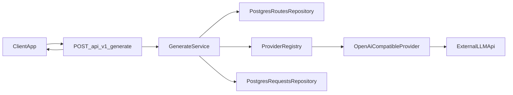

# AI Gateway Architecture

## Назначение

`ai-gateway` — тонкий внутренний HTTP-сервис для генерации текста и структурированного Tool Calling. Клиенты знают только внутренний alias модели и единый endpoint, а gateway сам:

- резолвит alias в реальный provider и внешнюю модель;
- вызывает внешний AI API через provider adapter;
- нормализует текст, tool calls, finish reason и usage в свой внутренний контракт;
- сохраняет историю запроса в PostgreSQL.

Главный принцип MVP: минимальная архитектура без универсального AI-runtime.

## Слои

### HTTP/API

- `POST /api/v1/generate`
- `GET /api/admin/tenants/:tenant_id/requests`
- `GET /api/admin/tenants/:tenant_id/requests/:id`
- `GET /api/admin/tenants/:tenant_id/providers`
- `GET /api/admin/tenants/:tenant_id/model-routes`
- `GET /health`

HTTP-слой отвечает только за transport, сериализацию JSON и преобразование ошибок в HTTP responses.

### Domain DTO и use case

Внутренний контракт gateway описан в `src/domain/mod.rs`, а сценарий `request -> response` реализован в `src/usecases/generate.rs`.

Use case делает только практические шаги:

1. валидирует запрос;
2. находит alias в `model_routes`;
3. получает provider-конфиг;
4. выбирает adapter по `provider kind`;
5. вызывает внешний API;
6. сохраняет запись в `requests`;
7. возвращает нормализованный ответ клиенту.

Запросы с инструментами дополнительно проходят проверку имён, структуры JSON Schema, политики выбора, размера и связности истории вызовов / результатов. Это проверка входного контракта, без выполнения инструментов или управления агентом.

### Provider adapters

Внешние LLM API скрыты за `ProviderAdapter`.

Сейчас реализован один adapter:

- `openai-compatible`

Он использует `reqwest` и умеет:

- работать через настраиваемый `base_url`;
- отправлять `chat/completions`;
- забирать usage и finish reason;
- нормализовать ошибки upstream;
- преобразовывать definitions, политику выбора, assistant tool calls и tool results;
- принимать ответы только с tool calls и проверять JSON-аргументы по объявленной схеме.

Все OpenAI-specific envelopes и строковая сериализация аргументов остаются внутри adapter. Общий контракт вызова — `{id, name, arguments}`. `finish_reason` типизирован: `stop`, `length`, `tool_calls`, `content_filter`, `unknown`. Для старых клиентов `output_text` всегда строка, включая `""` при вызовах без текста.

### Storage / repository

Хранилище намеренно простое:

- `PostgresRoutesRepository`
- `PostgresRequestsRepository`

Repository-слой не знает про HTTP и не содержит логики вызова провайдера.

### Конфигурация маршрутов

Маршруты и providers хранятся в PostgreSQL с tenant scope. Существующий механизм `provider_secrets` хранит ключи encrypted-at-rest; master key приходит из `GATEWAY_MASTER_KEY` в env.

Это даёт удобный компромисс:

- alias и маршруты можно читать и сохранять через admin API;
- machine token определяет tenant, внутри которого разрешаются routes и secrets;
- plaintext provider keys не возвращаются из read API и не сохраняются в истории запросов.

## Поток запроса



## Граница Tool Calling и Factum

```text
Factum -> POST /api/v1/generate (messages + tool definitions)
Gateway -> ProviderAdapter -> LLM
LLM -> ProviderAdapter -> Gateway -> Factum (tool_calls + usage)
Factum выполняет инструменты
Factum -> POST /api/v1/generate (assistant calls + tool results)
Gateway -> ProviderAdapter -> LLM -> Factum (final answer)
```

Каждый запрос — один completion; существующий технический retry параметра token limit остаётся внутри adapter. Gateway не запускает agent loop, не подключается к MCP, не выбирает бизнес-инструменты и не управляет историей Factum. Клиент передаёт нужную историю каждый раз. [Полный JSON-пример](docs/rest-api.md#полный-цикл-tool-calling).

Поддержка tools зависит от upstream-модели, явный отказ даёт `400 tool_calling_not_supported`. Статического списка моделей нет. Маршрутизация по alias, machine auth и tenant-local secrets остаются в существующих слоях.

Лимиты: 2 MiB request, 256 сообщений, 128 definitions / вызовов в сообщении, 64 KiB на схему / аргументы; upstream response ограничен 4 MiB. JSON Schema проверяется библиотекой `jsonschema`, сетевое и файловое разрешение ссылок отключено. Вызовы с некорректными аргументами отклоняются, частичный успех не возвращается.

В истории запросов сохраняются usage, latency, status и routing, включая ошибки разбора вызовов с доступным usage. Prompt/response preview в сценариях tools отключаются, сырые upstream errors не попадают в БД или HTTP errors. Логи ошибок записываются до возврата HTTP error. Runtime-инструменты, полная история и аргументы не добавляются в storage schema.

## Почему `axum`

Для этого MVP выбран `axum`, потому что он:

- лёгкий и хорошо подходит для простого JSON API;
- естественно работает с `tokio`, `tower` и `tracing`;
- не навязывает тяжёлую архитектуру;
- удобно отдаёт статический admin UI из того же сервиса.

Для тонкого gateway это практичнее, чем строить более тяжёлую серверную обвязку.

## Почему `sqlx`

`sqlx + PostgreSQL` выбраны как минимальный внятный путь для боевого хранения:

- история запросов;
- providers;
- alias routes.

ORM не добавлялся сознательно, чтобы не усложнять модель данных.

## Что уже реализовано

- единый endpoint `POST /api/v1/generate`;
- routing по alias модели;
- один рабочий provider adapter `openai-compatible`;
- хранение истории запросов в PostgreSQL;
- базовый admin API;
- минимальный PrimeVue admin;
- запуск в одном Docker-контейнере с PostgreSQL внутри.

## Архитектурное направление

Ближайший фокус — отточить `openai-compatible`, потому что это самый дешёвый путь получить рабочий gateway для OpenAI и OpenAI-compatible провайдеров.

При этом core проекта не должен становиться OpenAI-centric:

- основной контракт gateway остаётся внутренним `POST /api/v1/generate`;
- OpenAI request/response shapes живут внутри `src/providers/openai_compatible.rs`;
- use case работает через `ProviderAdapter`, а не через OpenAI DTO;
- новые внешние протоколы добавляются отдельными adapters по `provider.kind`;
- входящие OpenAI-compatible endpoints, если появятся, должны быть compatibility layer поверх `GenerateService`, а не новым core API.

Подробнее: `docs/provider-strategy.md`.

## Что сознательно отложено

- streaming;
- SSE/WebSocket;
- embeddings;
- выполнение tools и agent orchestration;
- file upload;
- image generation;
- fallback orchestration;
- quotas/billing;
- UI-редактирование providers и routes;
- детальная event-история в отдельной таблице.

## Как добавить нового provider

1. Добавить новый adapter в `src/providers/`.
2. Реализовать `ProviderAdapter`.
3. Зарегистрировать его в `src/main.rs`.
4. Добавить запись в таблицу `providers` с новым `kind`.
5. Привязать alias к этому provider через `model_routes`.

Текущий контракт adapter намеренно узкий: один generation call с текстом и/или структурированными tool calls, без streaming и исполнения инструментов.

## Как добавить новый alias модели

Достаточно добавить строку в `model_routes`, например:

```sql
INSERT INTO model_routes (alias, provider_code, external_model, is_enabled)
VALUES ('cheap-default', 'openai', 'gpt-4.1-mini', TRUE);
```

Клиенты после этого продолжают ходить только в gateway и знают лишь alias.

## Ограничения MVP

- только синхронный сценарий `request -> response`;
- только один реализованный provider kind;
- preview в истории сокращённый и не предназначен для полного аудита;
- для локальной простоты PostgreSQL живёт в том же контейнере, что и приложение;
- текущий UI только читает данные, но не редактирует конфигурацию.
